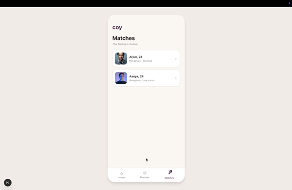

# Coy SDE Intern Assignment

A standalone, mobile-first **Discover** tab and mutual-matching experience built for **[Coy](https://app.getcoy.com)**. Built with Next.js 16 (App Router), React 19, TypeScript, and Tailwind CSS.

---

## Quick Start (Run Locally)

```bash
# 1. Install dependencies
npm install

# 2. Run local development server
npm run dev

# 3. Open in your browser
http://localhost:3000
```

---

## Part A: Product Feedback & Feature Suggestions

The comprehensive live app teardown and feature suggestions are documented in:
👉 **[`PART_A_SUBMISSION.md`](./PART_A_SUBMISSION.md)**

### Summary of Suggested Features:
1. **Slot Recycling (Reclaiming Inactive Slots after 14–21 Days):** Prevents accounts from hitting a dead end when selected crushes don't join or are inactive, protecting long-term retention.
2. **Verified Campus & Circle Context in Anonymous SMS:** Replaces generic spam-like text alerts with verified college circle context to dramatically boost SMS-to-signup conversion while preserving 100% sender anonymity.

*Please refer to [`PART_A_SUBMISSION.md`](./PART_A_SUBMISSION.md) for full flow observations, edge case handling, and in-depth rationales.*

---

## Part B: Discover Tab Implementation

### 📱 Demo Video
Watch the mobile walk-through of the Discover tab, card dragging, mutual matching celebration, matches list, and profile detail view:

[](./demo/coy-discover-demo.mp4)

* 🎥 **[▶ Click here to view / play the Demo Video (MP4)](./demo/coy-discover-demo.mp4)**
* 📦 *Original Apple QuickTime recording also available at [`demo/coy-discover-demo.mov`](./demo/coy-discover-demo.mov)*

### Key Features
1. **Swipe Experience (Mobile Drag + Desktop Buttons):**
   * Drag card right or click `♥` to **Like**.
   * Drag card left or click `×` to **Pass**.
   * Real-time visual stamps (`LIKE` in green, `PASS` in red) as you drag.
   * Swiped cards are permanently filtered out and never appear again.
2. **Strict Mutual Matching:**
   * A match happens **only** when both users like each other. One-sided likes simply slide away with zero awkwardness and no data leakage.
   * When both users like each other, an animated **"It's a match!"** celebration screen appears.
3. **Matches Tab & Profile Detail View:**
   * Lists all mutual matches with thumbnails, names, and college/interests.
   * Clicking any match row opens their **full profile card** (same rich details as Discover) with a *"Send a note"* action.
4. **Empty State & Demo Reset:**
   * When all 32 profiles are swiped, shows *"You're all caught up"* with a **"↺ Reset Profiles"** button to easily replay the demo.

### Backend APIs
* `GET /api/feed`: Returns unswiped profiles. Strips `hasLikedUser` server-side to guarantee zero client-side enumeration or data leakage.
* `POST /api/swipe`: Records like/pass with timestamps. Evaluates mutual match.
* `GET /api/matches`: Returns mutual matches.
* `POST /api/reset`: Resets demo state to 32 fresh profiles.
